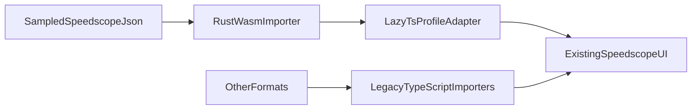

# Speedscope Rust/WASM Migration Showcase

This repository preserves the original [Speedscope](https://github.com/jlfwong/speedscope) codebase while documenting a real migration of its hottest sampled-profile import path to Rust/WASM, orchestrated with Cursor cloud agents.


If you are opening this repo to understand what happened, there are six things to look at:

1. The original Speedscope code is still here in [`src/`](./src/), [`assets/`](./assets/), and [`sample/profiles/`](./sample/profiles/).
2. The new Rust/WASM code lives in [`rust/`](./rust/) and the adapter seam lives in [`src/experimental/`](./src/experimental/).
3. The cloud-agent control plane lives in [`scripts/cloud-control-plane.ts`](./scripts/cloud-control-plane.ts) and is surfaced in [`cloud-agents/`](./cloud-agents/).
4. The old and new architectures are documented in the showcase docs under [`docs/`](./docs/).
5. You can run the classic and Rust-backed UIs side by side on two local ports.
6. A React/MDX showcase site under [`site/`](./site/) turns the migration into a readable, reproducible case study.

## What this repo demonstrates

- A measured Rust/WASM seam inserted into an existing browser app without rewriting the UI.
- A cloud-agent orchestration system that broke the migration into packages, routed work by task shape, and kept parity/benchmark gates visible.
- A side-by-side validation flow where the same profile file can be opened in both the classic and experimental UIs.
- Benchmark evidence that the Rust/WASM sampled-import path reduces both time and heap pressure on larger inputs.

## Project summary

- **Goal:** prove that Speedscope's hottest sampled-profile import path could be migrated to Rust/WASM for real, benchmarkable wins without rewriting the UI.
- **Constraint:** keep the original Speedscope codebase visible and runnable so the migration could always be compared against the legacy implementation.
- **Approach:** add a narrow Rust seam for sampled Speedscope JSON, keep other formats on the legacy TypeScript importers, and adapt the Rust result back into the existing `Profile` surface.
- **Cursor SDK / cloud-agent role:** use a control plane around Cursor cloud agents to split the migration into packages, route work by task shape, keep registry-backed state, and gate progress with parity and benchmark checks.
- **Model split:** Composer handled bounded execution-heavy worker tasks, GPT-5.4 handled orchestration and synthesis, and the Opus deep-reasoning slot handled ambiguous or high-blast-radius escalations.
- **Proof:** this repo includes side-by-side UI runs, benchmark artifacts, curated fixtures, and the orchestration code that made the migration repeatable instead of ad hoc.

## Quickstart

```bash
npm install
npm run showcase:install
```

Launch the showcase/docs site:

```bash
npm run showcase:dev
```

Launch the two UI ports:

```bash
npm run serve:side-by-side
```

Ports:

- Showcase/docs site: `http://127.0.0.1:4321`
- Classic Speedscope UI: `http://127.0.0.1:8000`
- Rust/WASM-backed UI: `http://127.0.0.1:8001`

## Exactly how to run it

### 1. Optional: rebuild the Rust/WASM packages

Run this if you want to regenerate the wasm bundles from the Rust crate instead of relying on the checked-in generated packages.

```bash
npm run experiment:build-rust-wasm
```

### 2. Run the original Speedscope UI only

This keeps the classic importer as the default path.

```bash
npm run serve:classic-ui
```

Open: `http://127.0.0.1:8000`

### 3. Run the Rust/WASM-backed UI only

This keeps the same UI, but makes the experimental importer the default path.

```bash
npm run serve:wasm-ui
```

Open: `http://127.0.0.1:8001`

### 4. Run both at the same time

This is the best way to validate the project publicly.

```bash
npm run serve:side-by-side
```

Open:

- Classic UI: `http://127.0.0.1:8000`
- Rust/WASM UI: `http://127.0.0.1:8001`

### 5. Run the docs/showcase site

```bash
npm run showcase:dev
```

Open: `http://127.0.0.1:4321`

## Repo map

- Original Speedscope source: [`src/README.md`](./src/README.md)
- Rust/WASM importer path: [`rust/README.md`](./rust/README.md)
- Experimental seam and adapters: [`src/experimental/README.md`](./src/experimental/README.md)
- Cloud-agent orchestration: [`cloud-agents/README.md`](./cloud-agents/README.md)
- Demo fixtures: [`demo/fixtures/README.md`](./demo/fixtures/README.md)
- Public showcase/docs site: [`site/`](./site/)

## Architecture at a glance

### Before


The original architecture is broad and flexible, but large sampled imports pay for full JavaScript text decode, eager parsing, eager object construction, and duplicated tree-building work before the UI renders.

### After



The UI remains the same. The targeted change is that sampled Speedscope JSON can now enter through Rust/WASM first, then adapt into the existing `Profile` surface lazily.

## Benchmark highlights

- `11.3 MB` sampled synthetic input: experimental `-84.2%` faster (`161.84 ms` vs `1023.31 ms`)
- `28.1 MB` sampled synthetic input: experimental `-85.5%` faster (`392.48 ms` vs `2699.83 ms`)
- `56.1 MB` sampled synthetic input: experimental `-85.2%` faster (`796.81 ms` vs `5396.14 ms`) while using about `0.06 GB` vs `5.82 GB`
- `112.1 MB` sampled synthetic input: experimental `-7.9%` faster head to head (`8784.47 ms` vs `9539.29 ms`) while using about `0.12 GB` vs `5.98 GB`

The strongest proof in this repo is the sampled-import path. Other formats still rely on the legacy importer surface and are preserved as part of the original Speedscope breadth.

## Run it yourself

### Recommended validation files

- **Use this first to exercise the new Rust path directly:** [`sample/profiles/speedscope/0.6.0/two-sampled.speedscope.json`](./sample/profiles/speedscope/0.6.0/two-sampled.speedscope.json)
- **Generate this locally for the heavy-load Rust demo:** `demo/fixtures/generated/synthetic-sampled-1m.speedscope.json`
- **Use this next to show the repo still preserves original Speedscope breadth:** [`sample/profiles/Chrome/116/Trace-20230603T221323.json`](./sample/profiles/Chrome/116/Trace-20230603T221323.json)
- **Use this for a fast smoke test:** [`sample/profiles/stackcollapse/simple.txt`](./sample/profiles/stackcollapse/simple.txt)
- **Use this to show another preserved legacy format:** [`sample/profiles/callgrind/callgrind.example.log`](./sample/profiles/callgrind/callgrind.example.log)

### Generate the 112 MB sampled demo file

```bash
npm run experiment:benchmark-rust-sampled -- --samples=1000000 --runs=1 --skip-parity=1 --write-file=demo/fixtures/generated/synthetic-sampled-1m.speedscope.json
```

### Best test sequence

1. Start with `npm run serve:side-by-side`.
2. Load `two-sampled.speedscope.json` in both ports.
3. Confirm the UI looks the same in both tabs.
4. Generate and load `demo/fixtures/generated/synthetic-sampled-1m.speedscope.json` in both ports for the large-file benchmark demo.
5. Load the Chrome trace fixture to show that the broader format surface still works.
6. If you want a very quick sanity check, use the stackcollapse fixture.

### What each run mode is good for

- **Classic only (`serve:classic-ui`):** useful when you want the original behavior in isolation.
- **Rust/WASM only (`serve:wasm-ui`):** useful when you want to exercise the new default path without mentally comparing two tabs at once.
- **Both (`serve:side-by-side`):** best for demos, screenshots, and proving the unchanged UI claim.

## Cloud agents are the headline

If this repository only contained a Rust crate and a benchmark table, it would be an optimization fork. What makes it worth showing off is the orchestration layer:

- package graph
- model routing policy
- parity and benchmark gates
- retryable registry-backed execution
- integration synthesis and cutover checks

The model-routing story is part of the point: Composer handled bounded execution-heavy worker tasks, GPT-5.4 handled orchestration and synthesis, and the Opus deep-reasoning slot was reserved for ambiguous or high-blast-radius escalations. In the original planning we described that deep slot as the Opus 4.6-style path; in the current control-plane defaults it resolves to `claude-opus-4-7-thinking-max`.

Start with [`cloud-agents/README.md`](./cloud-agents/README.md), then read the actual control plane in [`scripts/cloud-control-plane.ts`](./scripts/cloud-control-plane.ts).

## Credit

The original application and architecture come from upstream Speedscope by John Wong. This repo is a public migration case study built on top of that preserved codebase, not a claim that the original Speedscope design was incorrect.
